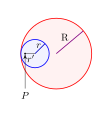

#+TITLE: spiro
#+AUTHOR: kpm

This file is [[https://pub.krzysckh.org/spiro.pdf][available online as a PDF file]].

* Obligatory screenshot

[[https://img.krzysckh.org/fpfmpsap.png]]

* Building

This boldly assumes raylib (ver. 5) is already installed on the machine.

#+BEGIN_SRC
$ make
#+END_SRC

* Sliders

#+CAPTION: Construction of a spirograph.

# \begin{tikzpicture}
# \draw[color=red!100, fill=red!5, thick](0,0) circle (1.25);
# \draw[color=blue!100, fill=blue!5, thick](-0.75,0) circle (0.5);
# \draw[color=black!100, fill=black](-1.10,0) circle (0.025);
# \node at (0.3,0.58) {$\text{R}$};
# \node at (-0.62,0.28) {$r$};
# \node at (-0.9,-0.17) {$r'$};
# \node (node1) at (-1.1,-1.48) {$P$};
# \draw[blue!78!black, thick] (-0.75,0) -- (-0.4,0.35);
# \draw (-1.1,0) -- (-0.75,0);
# \draw[violet, thick] (0,0) -- (0.95,0.8);
# \draw[arrows=-Stealth] (node1.north) -- (-1.1,-0.03);
# \end{tikzpicture}

The outer circle is always the size of the window \( R = \frac{SIZ}{2} \). By default, \( SIZ = 600 \) is used for window size.

Sliders control (in order):
- the radius of the inner circle (\( r \)),
- the "second radius" (\( r' \)), which is the distance of the target point (\(P\)) from the center of the inner circle,
- the quality (step size - lower is better),
- the number of rotations (higher is better),

* keybinds

| keybind | description          |
|---------+----------------------|
| =a=       | animate              |
| =e=       | export to =export.ppm= |

